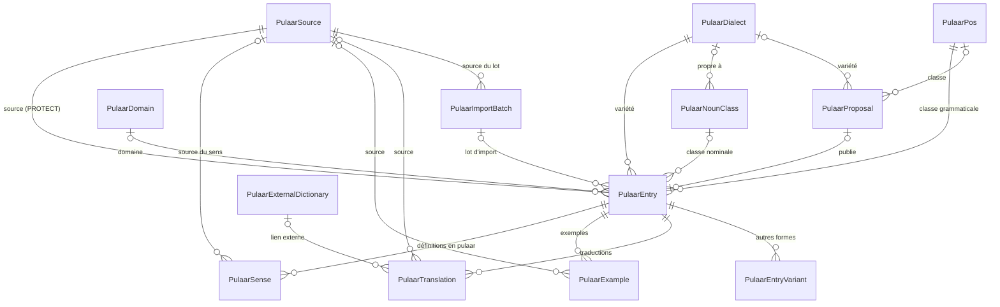

# Structure de la base du dictionnaire Pulaar (modèle « v6 » porté en Django)

> État au 2026-11-22, commits `6df203a` et `77b89b8`, en production sur Supabase. Généré à partir des modèles `v2/site/kaloum24_v2/pulaar/models.py`. Le plan et les décisions : `docs/PLAN_DICTIONNAIRE_PULAAR.md`.

## 1. Principes

1. **Le pulaar est la base** : une entrée n'est « validée » que si elle a au moins un sens rédigé en pulaar.
2. **Les autres langues sont des traductions, pas des définitions**, avec un lien facultatif vers un dictionnaire externe (Wiktionnaire fr, Wiktionary en au départ).
3. **Provenance partout** : entrée, sens, exemple et traduction pointent vers une source. Chaque source a un statut de droits ; tant qu'il est « à vérifier », « demandée » ou « restreinte », ses entrées **ne sont pas affichées au public**.
4. **L'IA propose, un humain valide** : les propositions passent par `pulaar_pulaarproposal`. Une zone d'import complète (lots, texte brut, auteur « IA ») viendra à la phase suivante.
5. **Une langue, plusieurs variétés** : chaque entrée porte le code ISO 639-3 de sa variété (`fuf` Pular de Guinée, `fuc` Pulaar du Sénégal et de Mauritanie, `ffm`, `fue`, `fuh`, `fuq`, `fuv`, `fub`, `fui`), plus `ful` pour « variété non précisée ».

## 2. Schéma des relations

## 3. Règles imposées

| Règle | Où |
|---|---|
| Entrée « validée » ⇒ au moins un sens en pulaar | modèle (`save`), formulaire d'admin (message clair), commande `verifier_dictionnaire` |
| Pas de doublon d'entrée : (dialecte, mot, classe, n° d'homonyme) | contrainte d'unicité en base |
| Pas de doublon de traduction : (entrée, langue, mot) | contrainte d'unicité en base |
| Langue d'une traduction : code ISO 639-3 sur 3 lettres | validateur |
| Lien externe : `https`, contient `{term}`, domaine dans `wiktionary.org`, `wikipedia.org`, `webonary.org` (ou sous-domaine) ; mot encodé à l'affichage | `PulaarExternalDictionary.clean()` / `url_for()` |
| Source supprimable seulement si plus aucune entrée, sens, exemple ou traduction ne l'utilise | `PROTECT` |
| Public : ni brouillon, ni source aux droits non établis (`public_domain`, `open_license`, `permission_granted` seulement) | `PulaarEntry.objects.publiques()` |
| Une proposition validée crée une entrée « documentée », jamais « validée » ; la traduction française reste une traduction | `PulaarProposal._publier()` |
| Mot du jour : seulement une entrée publique **avec** une définition en pulaar | `mot_du_jour()` |

## 4. Tables

### `pulaar_pulaardialect` — dialecte

Variété de la langue. Le code est le code ISO 639-3. `ful` = macro-langue (variété non précisée).

| Champ | Type | Contraintes / rôle |
|---|---|---|
| `id` | AutoField | ID — clé primaire |
| `code` | CharField(10) | code ISO 639-3 — unique |
| `name` | CharField(120) | nom |
| `region` | CharField(200) | région / pays — facultatif |

### `pulaar_pulaarpos` — classe grammaticale

Classes grammaticales (table modifiable dans l'admin). Aucun nom pulaar n'est inventé : `name_ff` reste vide tant qu'un locuteur ne le fournit pas.

| Champ | Type | Contraintes / rôle |
|---|---|---|
| `id` | AutoField | ID — clé primaire |
| `code` | SlugField(30) | code — unique |
| `name_fr` | CharField(60) | nom en français |
| `name_ff` | CharField(60) | nom en pulaar — facultatif |
| `is_verbal` | BooleanField | verbe — défaut `False` |

### `pulaar_pulaarnounclass` — classe nominale

Classes nominales (24 à 26 selon les variétés). Structure prête, **vide** : la liste vient d'une source citée.

| Champ | Type | Contraintes / rôle |
|---|---|---|
| `id` | AutoField | ID — clé primaire |
| `marker` | CharField(30) | marqueur |
| `dialect` | ForeignKey | dialecte — → `pulaar_pulaardialect` (PROTECT); nul possible |
| `note` | TextField | description / source — facultatif |

**Contraintes d'unicité :** `uq_nounclass_dialect_marker` (dialect, marker)

### `pulaar_pulaardomain` — domaine

Domaine thématique (Agriculture, Technologie…), créé depuis l'admin.

| Champ | Type | Contraintes / rôle |
|---|---|---|
| `id` | AutoField | ID — clé primaire |
| `name` | CharField(100) | nom — unique |
| `slug` | SlugField(120) | slug — unique |

### `pulaar_pulaarsource` — source

Provenance de chaque donnée, avec le statut des droits de réutilisation.

| Champ | Type | Contraintes / rôle |
|---|---|---|
| `id` | AutoField | ID — clé primaire |
| `name` | CharField(200) | nom |
| `url` | CharField(500) | lien — facultatif |
| `license` | CharField(100) | licence — facultatif |
| `method` | CharField(30) | méthode |
| `rights_status` | CharField(30) | droits de réutilisation — défaut `to_check`; choix : `public_domain`, `open_license`, `permission_granted`, `permission_pending`, `to_check`, `restricted` |
| `rights_note` | TextField | note sur les droits — facultatif |

### `pulaar_pulaarexternaldictionary` — dictionnaire externe

Dictionnaire externe (Wiktionnaire…). Le lien est construit à l'affichage : modèle + mot encodé, domaines autorisés uniquement.

| Champ | Type | Contraintes / rôle |
|---|---|---|
| `id` | AutoField | ID — clé primaire |
| `code` | SlugField(30) | code — unique |
| `name` | CharField(100) | nom |
| `language_code` | CharField(3) | langue (ISO 639-3) |
| `url_template` | CharField(300) | modèle d'adresse |
| `notes` | TextField | notes — facultatif |

### `pulaar_pulaarentry` — entrée

**Le mot (lemme)**. Une entrée = un dialecte + un mot + une classe grammaticale + un n° d'homonyme.

| Champ | Type | Contraintes / rôle |
|---|---|---|
| `id` | AutoField | ID — clé primaire |
| `lemma` | CharField(200) | mot (lemme) |
| `slug` | SlugField(220) | slug — unique |
| `dialect` | ForeignKey | dialecte — → `pulaar_pulaardialect` (PROTECT) |
| `pos` | ForeignKey | classe grammaticale — → `pulaar_pulaarpos` (PROTECT) |
| `homonym_index` | PositiveSmallIntegerField | n° d'homonyme — défaut `1` |
| `noun_class` | ForeignKey | classe nominale — → `pulaar_pulaarnounclass`; nul possible |
| `domain` | ForeignKey | domaine — → `pulaar_pulaardomain`; nul possible |
| `source` | ForeignKey | source — → `pulaar_pulaarsource` (PROTECT) |
| `status` | CharField(20) | statut — défaut `documented`; choix : `draft`, `documented`, `validated` |
| `created_at` | DateTimeField | created at |

**Contraintes d'unicité :** `uq_entry_homonym` (dialect, lemma, pos, homonym_index)

### `pulaar_pulaarsense` — sens

Un sens = une définition **en pulaar uniquement**.

| Champ | Type | Contraintes / rôle |
|---|---|---|
| `id` | AutoField | ID — clé primaire |
| `sort_order` | IntegerField | sort order — nul possible |
| `entry` | ParentalKey | entry — → `pulaar_pulaarentry` |
| `text` | TextField | définition en pulaar |
| `source` | ForeignKey | source de la définition — → `pulaar_pulaarsource` (PROTECT); nul possible |
| `source_locator` | CharField(100) | page / n° d'entrée — facultatif |

### `pulaar_pulaarexample` — exemple

Exemple d'emploi en pulaar, avec traduction facultative et source.

| Champ | Type | Contraintes / rôle |
|---|---|---|
| `id` | AutoField | ID — clé primaire |
| `sort_order` | IntegerField | sort order — nul possible |
| `entry` | ParentalKey | entry — → `pulaar_pulaarentry` |
| `sense_number` | PositiveSmallIntegerField | n° du sens illustré — nul possible |
| `text` | TextField | exemple en pulaar |
| `translation` | TextField | traduction (facultatif) — facultatif |
| `source` | ForeignKey | source — → `pulaar_pulaarsource` (PROTECT); nul possible |
| `source_locator` | CharField(100) | page / n° d'entrée — facultatif |

### `pulaar_pulaartranslation` — traduction

Équivalent dans une autre langue. **Ce n'est pas une définition.**

| Champ | Type | Contraintes / rôle |
|---|---|---|
| `id` | AutoField | ID — clé primaire |
| `sort_order` | IntegerField | sort order — nul possible |
| `entry` | ParentalKey | entry — → `pulaar_pulaarentry` |
| `sense_number` | PositiveSmallIntegerField | n° du sens (facultatif) — nul possible |
| `language_code` | CharField(3) | langue (ISO 639-3) |
| `term` | CharField(300) | mot ou expression |
| `external_dictionary` | ForeignKey | dictionnaire externe — → `pulaar_pulaarexternaldictionary`; nul possible |
| `source` | ForeignKey | source — → `pulaar_pulaarsource` (PROTECT); nul possible |
| `is_validated` | BooleanField | vérifiée — défaut `False` |

**Contraintes d'unicité :** `uq_translation_entry_lang_term` (entry, language_code, term)

### `pulaar_pulaarproposal` — proposition

File de relecture des propositions du public. Jamais publiée directement.

| Champ | Type | Contraintes / rôle |
|---|---|---|
| `id` | AutoField | ID — clé primaire |
| `term_lemma` | CharField(200) | mot proposé |
| `definition_ff` | TextField | définition en pulaar — facultatif |
| `translation_fr` | CharField(300) | traduction en français (facultatif) — facultatif |
| `dialect` | ForeignKey | dialecte — → `pulaar_pulaardialect`; nul possible |
| `pos` | ForeignKey | classe grammaticale — → `pulaar_pulaarpos`; nul possible |
| `domain` | ForeignKey | domaine — → `pulaar_pulaardomain`; nul possible |
| `justification` | TextField | d'où vient ce mot ? — facultatif |
| `contributor_name` | CharField(120) | nom du contributeur — facultatif |
| `contributor_contact` | CharField(200) | contact du contributeur — facultatif |
| `proposed_by` | ForeignKey | proposed by — → `users_user`; nul possible |
| `status` | CharField(20) | statut — défaut `en_attente`; choix : `en_attente`, `valide`, `rejete` |
| `published_term` | ForeignKey | published term — → `pulaar_pulaarentry`; nul possible |
| `created_at` | DateTimeField | created at |

## 5. Données de départ (commande `seed_pulaar`, idempotente)

- **10 dialectes** : `ful`, `fuf`, `fuc`, `ffm`, `fue`, `fuh`, `fuq`, `fuv`, `fub`, `fui` (codes ISO 639-3 vérifiés).
- **10 classes grammaticales** : nom, verbe, adjectif, adverbe, pronom, conjonction, interjection, numéral, particule, à préciser (noms français seulement).
- **2 dictionnaires externes** : Wiktionnaire (français), Wiktionary (English).
- **22 entrées** issues de Wiktionary (CC BY-SA), rattachées à `ful`, sans définition en pulaar, avec leurs gloses françaises et anglaises enregistrées comme **traductions**.
- **Classes nominales : aucune** (à remplir depuis une source citée).

## 5 bis. Import par lots (migration 0003)

- **PulaarImportBatch** : source (PROTECT), nom du fichier, empreinte SHA-256, version du parseur, importé par, date, statut (`done`/`removed`), compteurs (entrées créées/ignorées, sens, exemples, variantes), notes (corrections appliquées).
- **PulaarEntryVariant** : entrée (cascade), forme, note ; unique (entrée, forme). Sert aux formes alternatives du mot vedette (« Aamde: Aamude »).
- **PulaarEntry.import_batch** : lot d'origine (SET_NULL) ; permet « Retirer le lot ».
- Import idempotent (clé dialecte + mot + classe + homonyme), entrées en `documented`, droits de la source forcés à `to_check`.
- **Aperçu équipe** : les entrées non publiques sont visibles des seuls comptes équipe (bandeau « Non public »), le public reçoit 404.

## 6. Ce qui n'est pas encore modélisé (phases suivantes)

- Zone d'import : lots faits ; reste le texte brut conservé, l'auteur parseur / IA / humain et le relecteur nominatif.
- Racines, mutations consonantiques, extensions verbales, voix verbale.
- Relations entre entrées (synonymes, dérivés) et **variantes dialectales d'un même mot**.
- **Origine du mot** (hérité du peul ou emprunt) pour mettre en avant les mots authentiques : choix du lexicographe, jamais calculé.
- Import / export LIFT.
